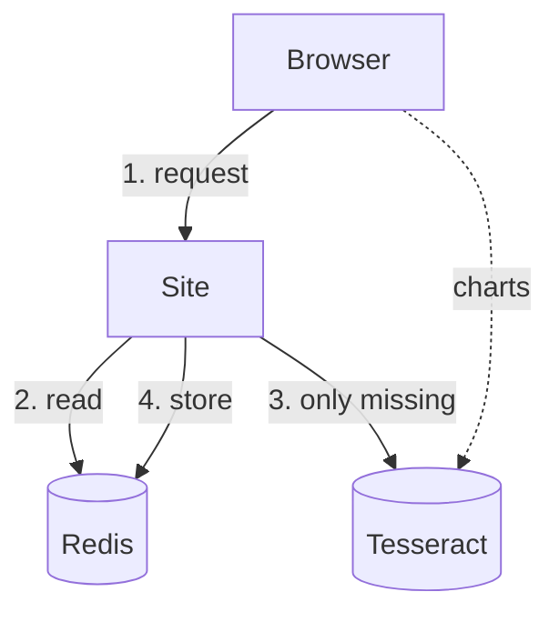
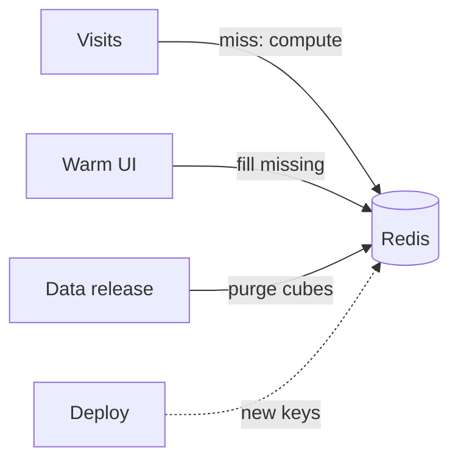

# Architecture — Data USA 2026 (Next.js rewrite)

Status: proposed 2026-10-09 after Phase 1 discovery (`docs/discovery.md`); updated as milestones land.

## Goals recap

- Content and configuration live in Git as TypeScript; data comes from Tesseract and the geoservice at request time.
- Any valid report URL renders on first request after a deploy: no build-time enumeration, no warm-up crawl.
- SEO-critical content (title, hero stats, about narrative, metadata, links) is in the server HTML.
- Charts are client islands mounting `@d3plus/core` 4.7 charts through our own small renderer (`src/components/viz/ChartRenderer.tsx`), loaded lazily per section.
- Deploy = `next build` + PM2 cluster behind the existing Nginx; no CMS database at runtime. One cache: generator outputs in Redis, outside the deploy cycle.

## Stack (pinned, see `package.json`)

Next.js 16.4.0 (App Router, Cache Components, standalone output), React 19.3, TypeScript 5.9 strict, `@d3plus/core` / `@d3plus/dom` / `@d3plus/text` / `@d3plus/color` / `@d3plus/export` 4.7.0, d3-array / d3-collection / d3-format / d3-time-format / d3-geo (the helper surface the legacy content code already uses), CSS Modules + global CSS, Node 24 LTS built-in `node:sqlite` (FTS5) for dimensions. Dev-only: `pg` + `tsx` for the one-time extraction scripts.

## Source layout

```
src/
  app/
    layout.tsx, page.tsx, not-found.tsx, robots.ts, sitemap/…
    profile/[slug]/[id]/page.tsx                 report (dynamic)
    profile/[slug]/[id]/[sslug]/[tslug]/page.tsx embed
    search/page.tsx, about/…
    api/search, api/geo/names, api/prism/*, api/revalidate     route handlers (only where needed)
  content/
    formatters/            35 formatters as TS functions (hand-converted)
    shared/                colors.json, icons.json, crosswalks, civic rosters
    reports/<type>/        one folder per report family
      profile.ts           ProfileMeta (slug, dimension, levels, cube, title/label)
      sections.ts          ordered SectionDefinitions (text templates, stats, allowed, selector + viz ids)
      selectors.ts         SelectorDefinitions
      attributes.ts        hand-written "custom attributes" (replaces api/customAttributes.js)
      generators/*.ts      one typed generator per file + index (ordered)
      materializers/*.ts   one typed materializer per file + index (ordered)
      visualizations/*.ts  one typed d3plus config function per file; manifest.ts (allowed, usedVariables); index.ts (lazy registry)
    pages/                 home, about, glossary… (TS/Markdown)
    registry.ts            typed map profile slug → template (static imports)
  lib/
    api/tesseract.ts       typed client: URL normalisation, fetch, parse, `use cache` + cacheTag (non-report callers)
    cache/                 the generator cache in Redis: keys, tags, purge, warmer (see "Generator cache")
    api/geoservice.ts
    dimensions/            SQLite access: resolveMember, search, images, parents, similar
    reports/               engine: attrs → generators → materializers → prepare sections (allowed, selectors, template swap)
    template.ts            `[[selector]]` + `Formatter{{var}}` renderer (regex, no eval)
    viz/                   client runtime: registry loader, d3plus theme, data loading, options
    seo/, formatting/, routing/
  components/
    layout/ (Nav, Footer, GA), report/ (Hero, Subnav, Section, Topic, Stat, SourceGroup, …), viz/ (VizIsland, Options)
scripts/legacy-export/     extract.ts (CMS → candidate TS files + manifest), build-dimensions.ts (JSONL → SQLite)
scripts/topojson/          build.sh (Census boundary files → public/topojson/PUMA.json, Districts.json)
scripts/school-districts/  build.sh (Census boundary files → public/topojson/SchoolDistrict_<state>.json + data/school-districts.jsonl)
data/                      members.jsonl, images.jsonl (versioned export), members-additions.jsonl (hand-added members), school-districts.jsonl (built from Census files) → dimensions.sqlite (built, gitignored)
public/                    icons, images, topojson (only files referenced by content), fonts
```

## Content model

The legacy CMS stores four kinds of things; each gets the simplest faithful representation:

| Legacy | New representation | Why |
|---|---|---|
| Section rows + `*_content` text with `{{var}}` / `Formatter{{var}}` / `[[selector]]` | `SectionDefinition` objects in `sections.ts`; text kept as template strings | Declarative; editors change prose without touching React; rendered by a 40-line typed template function (regex substitution, never `eval`) |
| `allowed` (variable name or `always`) | kept as string key; engine checks `variables[key]` truthiness exactly like Canon | Faithful, declarative |
| generator `api` + `logic` | `GeneratorDefinition {id, name, allowed, api(attrs), logic(resp, ctx)}` — `api` becomes a template-literal function, `logic` a real function body | Typed at the boundary (`ReportContext`, `TesseractResponse`), compiled by `tsc`, no runtime evaluation |
| materializer `logic` | `MaterializerDefinition {id, name, ordering, logic(variables, ctx)}` | same |
| visualization `logic` | `VizDefinition = (variables, ctx) => D3plusConfig`; `"[[sel]]"`/`"{{var}}"` string literals wrapped as `ctx.swap("…")` | Same semantics as Canon's selSwap/varSwap, but the code is a module |
| formatters | `content/formatters/index.ts` | hand-converted, unit-tested |
| selectors | `SelectorDefinition {name, title, type, default, options | dynamic}` | declarative |
| `api/customAttributes.js` (per dimension) | `content/reports/<type>/attributes.ts` | hand-converted, typed |

Generated files carry a header comment with the legacy table + id so the manifest can prove coverage. `scripts/legacy-export/manifest.json` lists every record, its output file, and any pattern the converter could not handle (reviewed by hand and tracked in `docs/migration-gaps.md`).

The `variables` namespace is dynamic by nature (1,794 keys for Massachusetts), so it is typed as `Variables = Record<string, unknown>` with helper accessors; generator/materializer/viz bodies keep their original loosely-typed inner code but are compiled as TypeScript.

## Request flow for `/profile/geo/massachusetts`

1. **Route** `app/profile/[slug]/[id]/page.tsx` (dynamic, no `generateStaticParams`). Unknown profile slug → 404. Member lookup via SQLite (`resolveMember`): slug or raw id; raw id → 301 to the slug URL (as today). Hidden members → 404.
2. **Attributes** (`content/reports/geo/attributes.ts`): breadcrumbs (geoservice intersects + SQLite names + population threshold via a cached Tesseract lookup), `stateDataID`, `pumsID`, election ids, colour maps, hosts. Cached per member in Redis (only when complete), tagged with what they read.
3. **Generators**: the engine evaluates each `api(attrs)`, groups generators by URL, reads every output from the generator cache in one `MGET`, fetches only the URLs of missing outputs (at most `API_MAX_CONCURRENCY` at a time), runs their `logic`, stores the successes, and merges all outputs in template order. Failures yield `{}` like Canon; the failed generators and the reason are recorded, and an incomplete render is logged.
4. **Materializers** run in order on the accumulated variables.
5. **Prepare**: selectors resolved from `searchParams` (validated against options, else default), `allowed` evaluated, Grouping visibility cascaded, text templates swapped. Output: a `PreparedReport` (plain data) used by server components.
6. **Render**: server components render Nav, Hero (title, subtitle, stats), Subnav (static markup; a small client enhancer tracks scroll), About (breadcrumbs, photo credit, narrative), Groupings → Topics (title, subtitles, stats, descriptions, sources). Each visualization becomes `<VizIsland id sectionSlug/>` — a client component that lazy-loads only that viz module, reads the report's variables from a once-serialised context (only keys the page's vizzes actually use, per the manifest), builds the d3plus config, and renders with `@d3plus/react` when it nears the viewport (`IntersectionObserver`, reserved height). Selector changes update URL search params and re-render the affected topic client-side (templates for selector-bearing topics are passed to the client; the rest stays server-only).
7. **Comparison** (`?compare=`) runs the engine for both members in parallel and renders paired columns server-side.
8. **Metadata**: `generateMetadata` reuses the prepared hero/about text for `<title>`, description, canonical, Open Graph image (legacy image host).

All of this happens per request with no page-level cache: the expensive part (generator outputs, attributes, lookups) is cached in Redis by cube, so a cold request is correct and a warm one is fast (a state in about 0.3 s of engine time). Nothing caches HTML.

## Caching and invalidation

**A page request.** Reports are assembled from cached generator outputs; nothing caches whole pages.



1. The browser asks for a report, for example `/profile/geo/texas`.
2. The site reads all the report's generator outputs from Redis in one round trip.
3. Only if some are missing, it fetches just those generators' queries from Tesseract.
4. It stores the new outputs, tagged by the cube each one read, and returns the page.

The page's charts (dotted line) query Tesseract from the browser and are not cached here.

**What fills and clears the cache.**



- **Visits** compute and store any output that is missing.
- **The warm** fills outputs ahead of visitors, only those that are missing. It uses the same engine as
  the site and asks Tesseract for many members per request (see "Batched warmer").
- **A data release** purges the changed cubes: every output that read them is deleted.
- **A deploy** deletes nothing: changed generators get new keys, and the old entries expire.
- **No host in any key**: the cache can be warmed against one API server and read by a site that uses
  another, as long as both carry the same data (see "Generator cache").

| Layer | Mechanism | Lifetime | Invalidation |
|---|---|---|---|
| Generator outputs, member attributes, lookup tables | Redis, shared by every worker and host (`src/lib/cache/`) | until purged (30-day TTL as a safety net) | purge by cube after a release (`npm run cache:purge -- --cubes …` or `POST /api/revalidate {"cubes": […]}`); a deploy only for the generators whose code changed |
| Other server data (home page, dataset pages, latest figures) | `use cache` in each worker, tags `tesseract` / `geoservice` / `external-data` | `cacheLife` profiles | `POST /api/revalidate {"tags": […]}` (one worker) or `pm2 reload` |
| Dimension lookups (SQLite) | in-process, synchronous | n/a | rebuild `data/dimensions.sqlite` + restart |
| Content | module code | deploy | git push → build → `pm2 reload` |
| Full page | none | n/a | n/a |

### Generator cache

Each entry is the output of one generator for one member, as JSON:

```
gen:<generator id>:<generator version>:<hash of the URL without its host>:<hash of the attributes given to the generator>
```

- **Version** (`data/generator-manifest.json`, built by `npm run build:manifest` before `next build`):
  a hash of the generator's module and an engine hash covering `src/lib/content/libs.ts`,
  `src/content/formatters`, `src/lib/reports/generator-run.ts` (slug injection and the logic call),
  URL normalisation and the `data/*.jsonl` inputs of the dimensions database, with the locked
  versions of the packages they import. Editing one generator changes only its key; editing shared
  code changes all of them. The manifest hashes source text and data, never the build (no build id,
  git sha or file times), so a deploy that changes no generator keeps every entry readable, and two
  builds of the same commit give identical manifests (`build-manifest.ts --check`). Generators that
  call in-process `/api/...` endpoints also carry the hash of `legacy-endpoints.ts` and what it imports.
- **URL, without its host**: the Tesseract and geoservice base URLs are replaced by placeholders
  (`{tesseract}/data.jsonrecords?…`, `hostFree` in `src/lib/cache/generator-cache.ts`). Keys never
  contain a host, so a cache warmed against one API server (api-penn.datausa.io) serves a site that
  reads another (api.datausa.io), and changing the API's hostname keeps the cache. The condition is
  that both servers carry the same data: which data an entry holds is tracked by its cube tags and
  the release purges, not by the host. Environments with different data must not share a Redis.
- **Attributes**: everything the logic reads besides the response (a state's parents change its
  key), except the `tesseract` and `geoservice` base URLs. Cached member attributes (`attrs:…`) and
  lookup tables (`lookup:…`) leave the host out of their keys too; attributes are stored without the
  two URLs, and the deployment's own are added back when they are read. The member id is stored in the value and in the tag sets, for tracing and the warmer.
- **Tags**: the entry is added to `cube:<name>` for the cube its URL reads (`cube=` or a path-style
  `/cubes/<name>`), `tag:geoservice` for geoservice URLs. In-process endpoints are tagged with every
  cube they read plus `tag:dimensions`; the tags come from what the computation actually fetched
  (`src/lib/api/upstream-scope.ts`), and an output whose reads cannot all be mapped is not stored
  (`scripts/cache/check-tags.mjs` renders the states and top counties and fails on any).
- **Only successes are stored**: a 2xx response with nothing failing underneath, logic that did not
  throw and returned an object or nothing, an output that survives the JSON round trip (`undefined`,
  `NaN` and the infinities are kept exactly, as markers; anything else that would change is reported
  and left uncached), and a generator not in `UNCACHED_GENERATORS`
  (`src/lib/cache/generator-cache.ts`: the four that read the calendar year, plus any ids in
  `GENERATOR_CACHE_SKIP`).
- **Failures are remembered, not stored**: a group that failed leaves a `failed|…` mark in its
  `lock:<key>`, naming the failed generators. Renders that find it answer at once (siblings from
  their entries, the failed generators with the remembered failure) instead of querying again. The
  mark lasts 6 h for answers a retry will not change (4xx, logic that threw, no data;
  `GEN_CACHE_FAILED_MS`) and 10 s for timeouts and network errors. **A 5xx is never remembered**
  (a requirement): every render that meets one retries it itself. Warm renders (the background
  warmer and `warm:batch`) ignore marks, query again and replace or clear them, so a re-warm after a
  data release (`--retry-failed`, `--retry-cubes`) is not held back. A changed generator or member
  gets a new key, so a code fix is never held back either; a purge alone does not clear marks, so
  without a re-warm a data release can take up to 6 h to fill a generator that used to fail with a
  4xx. Before this, every view of a
  cached page re-queried its failing generators (about 14 a page on geo reports), which limited
  penn to about 20 pages/s in the 2026-11-09 load test.
- **Generators that share a URL** share its response, and some of them change it for the next ones,
  so they are computed together whenever one of them is missing, as an uncached render would.
- **Purge-safe writes**: `cube-epoch` counts the purges of each tag. A render reads it before
  fetching and writes its entries with a Lua script only if no tag it carries was purged since, so a
  render in flight during a purge cannot write old data back.
- **Coalescing**: within a worker, renders share one computation per group; across workers the first
  takes `lock:<key>` (`SET NX PX`) and the others poll for its entries, then compute themselves if it
  gives up. Eight simultaneous views of an uncached state send one set of queries.
- **Redis failures never fail a page**: a read deadline (`REDIS_READ_TIMEOUT_MS`, 250 ms in production), a circuit breaker, and the render falls
  back to computing everything (with in-process coalescing). Without `REDIS_URL` the cache is off and
  attributes and lookups use Next's `use cache` (success-only) as before.
- **Purge** (`src/lib/cache/purge.ts`): per tag, bump its epoch, `SSCAN` its set, delete the entries,
  `SREM` them, queue their reports for the warmer, report the counts; unknown names are reported.
- **Warmer** (`src/lib/cache/warmer.ts`): one leader per Redis (lock `warmer:leader`) recomputes the
  queued reports through the same engine path, states first, then counties by population, at most
  `WARMER_MAX_QPS` Tesseract queries a second, pausing while user renders queue upstream. After a
  deploy that changed generator versions it queues the states and the top counties.
- **Instrumentation**: one log line per render (hits, misses, waits, Redis time, failed generators);
  `/api/debug/report` shows each generator's state and sends `x-gen-cache` and
  `x-report-generators`; report pages carry `data-gen-cache` and `data-report-generators` on
  `#Profile` (a streamed page cannot set headers).

### Batched warmer

`npm run warm:batch -- --plan <file>` (`scripts/cache/warm-batch.ts`, `src/lib/cache/batch-warm/`)
fills the generator cache for a list of reports in far fewer Tesseract queries than rendering them one
by one, and writes exactly the entries a page view would: every report still goes through the real
engine (`loadEngine`), with the same keys, tags and purge-safe writes. Only the fetch layer differs,
and only inside a warm run.

- **Plan without fetching.** `planReport(template, attrs)` (`src/lib/reports/engine.ts`) is the
  render's own planning (allowed generators, `g.api(attrs)`, URL groups); `upstreamUrlOf` gives the
  URL `fetchGeneratorUrl` would send, and `planGroupKeys` (`generator-cache.ts`) the keys the render
  reads and writes. A report whose keys all exist (or whose `warm:done:<profile>|<id>` marker matches
  its plan and still finds every key it stored) is a full hit and is skipped: rerunning a plan resumes it.
- **Warm scope.** The worker renders each member inside a warm scope (`src/lib/api/warm-scope.ts`,
  AsyncLocalStorage like `upstream-scope.ts`). `fetchJsonRaw` first asks the scope for the URL; the
  scope answers with a held response (parsed exactly as a fetched one) or nothing, and what it does
  not answer is fetched as usual, waiting for a slot of the run's global cap. Outside a warm run the
  scope does not exist and live renders, misses and purges are unchanged.
- **Fetched once per run.** URLs without the member id (national, state, county, lookups read inside
  in-process endpoints and attributes) go through the coordinator, which fetches each once for the
  whole run and keeps it (2 GB, least recently used). Member responses are freed as soon as the
  member is rendered. Only 2xx responses are held: a failed fetch is fetched again by the render,
  so the failure it records is the usual one.
- **Levels the cube lacks.** The coordinator reads `/tesseract/cubes` once. A query naming a level its
  cube does not have (drilldowns, include/exclude keys, cut parameters) is answered without calling
  Tesseract, with the failure Tesseract gives it. That failure is learnt from one real request per
  (endpoint, cube, missing levels, measures) and used only if it is the "Could not find a Level
  named …" 400; the render records it exactly as before (and, being a failure, stores nothing).
- **Shapes and batches.** A member-keyed URL's shape is the URL with the member id replaced by `{M}`,
  where the id is the whole value of an include entry (`include=Place:{M}`, also compound
  `include=Health Provider:1;State County:{M}`), of a cut parameter (`University={M}`) or of the
  `filter` of an RCA query (`complexity/rca_historical?…&filter=University:{M}`: the RCA is computed
  over every location and the filter only keeps rows), once and nowhere else. Per member group (300 members of one level, sorted by id), each shape becomes one or
  two queries with the ids in a list (under 6,000 characters of URL; 1,000 ids gave HTTP 414), the
  level added to `drilldowns` when missing (at the end, else at the start), split by the level's id
  column; the columns a single response does not have are removed, and `annotations`, `page` and
  `columns` are rebuilt in the batch's key order. `limit=N` with a `sort` is fetched without the
  limit and cut per member (`page.limit` and `page.total` as a single query reports them).
  `top=`, offsets, `calcs/` and the other `complexity/` queries are not batched. Members per batch
  are cut to keep a batched response near 4 MB.
- **Verification gate.** Before a shape is batched in a run, the split responses of 3 members (with
  data where the group has them) must equal their single responses byte for byte after canonical
  JSON (the keys of `annotations` sorted, since Tesseract returns them in a different order from one
  identical request to the next; rows, row keys and values compared as they are). Members a batch
  does not mention get the shape's empty response only when two real single responses of such
  members agreed (Tesseract answers an empty query with `columns: []`); otherwise they are fetched
  alone. Verified and rejected shapes are kept in Redis under `warm:shape:<hash of profile, level and
  shape>:<cube epoch>`, so a purge of the cube makes the next run verify again; transient rejections
  (5xx, timeouts, no member with data yet) are kept for the run only.
- **What the gate cannot see, handled per member.** `time=Year.latest[.N]` picks the periods among
  the rows a query matches, so a batch answers with the group's latest periods: a member is split
  only if it has rows in all of them; a member without rows is looked up in a presence query (the
  batch without `time`) and gets the empty response only if it has no data at all, else it is
  fetched alone. Tesseract orders rows tied on the `sort` column in no reproducible order, so a member
  whose rows tie on it is fetched alone.
- **Global cap.** All Tesseract requests of the run (workers and coordinator) share one cap: 16 at
  first, raised by 4 every 20 s up to 50 while requests wait and nothing fails, lowered by 40% on two
  or more 5xx/429/timeouts (a URL that keeps answering 5xx counts once, and a 5xx answered within a
  second, a query that always fails, not at all) or a p95 above 15 s, with a
  30 s pause after five errors. Every change is logged. `complexity/` and `calcs/` queries (10–50 s
  each on their own) run in a lane of an eighth of the cap and are left out of the p95. Waiting
  requests go in priority order: what renders and plans wait on, then shared, verification and
  batches, then single queries.
- **Geoservice.** Attributes and a few generators read the geoservice, which blocks a client that
  sends too many requests (429 with a challenge page, for a few minutes). In a warm run its requests
  go through the coordinator's own limiter (`--geo-rate`, default 4 a second, 4 at a time; a 429
  halves the rate and pauses a minute), the ones without the member id (a state's neighbours) are
  fetched once per run, and a 429 is retried three times inside the warm scope.
- **Output.** `progress.jsonl` every 15 s (reports, upstream requests by kind, shapes, cap, rate,
  p50/p95 per cube, Redis memory, workers' RSS and CPU), `upstream.jsonl` (every request sent),
  `logical-*.jsonl` (every logical URL and how it was served), `shapes.jsonl`, `skips.jsonl`,
  `summary.json`. One run at a time per Redis (`warm:batch:lock`).

Every server request to a data API host waits for one of the worker's `UPSTREAM_MAX_CONCURRENCY` slots for that host (`src/lib/api/limit.ts`, default 8), on top of the per-report `API_MAX_CONCURRENCY`, so the load on Tesseract is bounded by workers × slots however many reports are rendered at once (`docs/deployment.md`, "Protecting Tesseract").

## Dimensions (replaces `canon_cms_search` + lunr)

`scripts/legacy-export/build-dimensions.ts` exports the search and image tables to `data/members.jsonl` / `data/images.jsonl` (versioned, diffable) and `npm run build` compiles them into `data/dimensions.sqlite` (`members`, `members_fts` FTS5, `images`, `profiles`). `lib/dimensions` resolves slugs, powers `/search` and the hero search box, builds breadcrumbs and "Keep Exploring", and maps members to image ids. New members can be added by re-running the builder; no application build or restart is needed (a running server notices within seconds that the file was replaced and reopens it), and a member missing from SQLite but present in Tesseract still resolves by raw id through `tesseract/members`.

## School districts

School districts are 13,310 unified, elementary and secondary districts (Census summary levels 970, 950 and 960; ids like `97000US2502790`), treated as one level, "School District". Tesseract calls the level the same, with the ids and names of the Census 2024 boundary files: `State School District` > `School District` in the shared Geography dimension, with a `Type` property.

- **Members and shapes** come from the Census Bureau's cartographic boundary files, not from the legacy export: `scripts/school-districts/build.sh` writes `data/school-districts.jsonl` (name, slug, grade span, land area, an interior point) and `public/topojson/SchoolDistrict_<state FIPS>.json`. `build-dimensions.ts` loads the file into `members`, adds the level to the geo profile and fills a `school_districts` table with the extra columns. Members have no z-value (it is a popularity measure derived from data), so they rank on text relevance alone and a level listing is alphabetical. Tesseract has 13,305 of them; the five it lacks are the four island-area departments of education and Wyandanch, NY.
- **Data**: seven ACS 5-year cubes have the level, for 2024 only: `acs_yg_total_population_5`, `acs_ygs_median_age_total_5`, `acs_ygr_race_with_hispanic_5`, `acs_ygr_median_household_income_race_5`, `acs_yg_housing_median_value_5`, `acs_ygpsar_poverty_by_gender_age_race_5` and `acs_ygso_gender_by_occupation_c_5`. Every other cube lists the level (the dimension is shared) and answers a district cut with no rows; a district drilldown without a cut returns rows of other geographies with an empty name, so always cut by district.
- **Report**: `src/content/reports/geo/school-district.ts`, which `getTemplate` (`src/content/registry.ts`) returns for the level instead of the full location report (whose other sections would show "N/A" and empty charts). It is the location report's hero figures, its Race and Ethnicity, Occupations (workforce only, by sex) and Poverty sections, unchanged, with grouping texts rewritten for what a district has, and an About section with the boundary-file facts (kind, grades, land area), a data summary and the locator map. It runs 13 of the location report's generators and all its materializers. With no population for the district (a Tesseract server without the cubes, or a district without data) the data sections hide themselves and the page is the hero and About text from the boundary file. Chart 386 (occupations) was changed to keep its workforce figures when there is no earnings data (`scripts/legacy-export/patches.ts`).
- **Search**: members are found by the site search and the search page like any other. The search page draws every district as a point (as it does places), clustered until the map is zoomed in, and as shapes from 6x (secondary districts stay points, as they overlap elementary ones); there is no population column, ranking or sizing while the level is pending.
- **SEO**: the level is in `PENDING_LEVELS` (`src/lib/geo/levels.ts`) until the production Tesseract server has the cubes: its reports and search listing are `noindex, follow` and absent from the sitemap.
- **Photos**: a district shows its state's photo (and credit); the image host has none for districts.

When production has the data:

1. Remove the level from `PENDING_LEVELS`. Its reports are then indexed and enter the sitemap, and the search page stops saying the data is not available.
2. Add the level to `POPULATION_LEVELS` (`src/lib/dimensions/population.ts`) for the population column and ranking on the search page, and check the search map's point sizing; z-values can then be exported for search ranking.
3. As more cubes get the level, add their sections to the template (the location report's section, its generators by id, its charts) and check each against a district, as was done for the first seven.
4. `similarGeographies` is skipped for pending levels in `ReportPage.tsx`; check what the geoservice returns for district ids before enabling "Keep Exploring" similar places.

## Rendering responsibilities

Server components: everything textual. Client components: `VizIsland` (d3plus), `Options` (view data / CSV / PNG-SVG / share-embed), selector controls, Subnav scroll tracking, hero search + compare button, Prism gate form, GA consent hooks.

## Images

Profile splash/thumb images are served by this app: `GET /api/profile/<slug>/<member>/<splash|thumb|json>` reads the JPEGs from `profile-images/{splash,thumb}/<image id>.jpg` (outside Git, about 720 MB; `PROFILE_IMAGES_DIR` to put them elsewhere) and falls back to the nearest parent's photo, then a stock one (`src/lib/reports/images.ts`). `NEXT_PUBLIC_IMAGE_BASE_URL` can point pages at another host with the same paths.

## Deployment

`next build` → `.next/standalone` run by PM2 in cluster mode (`ecosystem.config.cjs`), `next start -p 3301` equivalent, Nginx proxies `/` to the cluster and serves `/_next/static` and `/public` with long cache headers. On the Docker hosts PM2 runs in the container built by `build.sh`; Redis runs in its own compose project (`compose-redis.yaml`) that deploys never touch. No database besides Redis and the Prism submissions table. Details in `docs/deployment.md` once Phase 8 lands.

## Decisions log

- 2026-10-09 Node 24 LTS (newest LTS; Node 26 becomes LTS late October 2026 and is a drop-in upgrade).
- 2026-10-09 SQLite via `node:sqlite` instead of Postgres for dimensions (legacy CMS DB will be decommissioned; FTS5 confirmed available).
- 2026-10-09 Template syntax `{{var}}`/`[[sel]]` kept for prose; JS bodies become modules; no interpreter.
- 2026-10-09 Images linked to the live host for now (user decision).
- 2026-10-09 `tesseract/data` URLs normalised to `data.jsonrecords` in the client to skip the 307.
- **Static pages are server components with global CSS ported from the legacy stylesheets** (`src/app/(site)/home.css`, `search/search.css`, `about/about.css`): the legacy class names are kept so the visual design carries over unchanged; only Blueprint widgets were replaced by native elements.
- **Home page data** (`src/lib/home/*`): report columns and the state map are `use cache` functions (hourly / `data` profile). Google Analytics popularity uses the GA4 Data API over REST with a service-account JWT signed by `node:crypto`, avoiding the `@google-analytics/data` dependency; without `GA_KEYFILE` the curated defaults are used.
- **Latest-data home page draft** (`/home-next`, `src/lib/latest/*`): headline figures fetched from the BLS public API (`bls.ts`, optional `BLS_API_KEY`) and EIA's weekly fuel price tables (`eia.ts`, no key needed), cached for hours under `external-data`. `indicators.ts` builds every headline and sentence from the numbers (pure functions), so the copy updates itself with each release; when a source fails the last good figures are kept. Not indexed; `/` is unchanged.
- **Search page** renders the first 100 results on the server (useful without JavaScript and for crawlers); filters and typing then query `/api/search` from the client and keep the URL in sync, as the legacy page did.
- **Section redirects** (`/about`, `/about/classifications`) live in `next.config.ts` rather than in pages, so they answer 308 before any rendering.
- **Status codes come from `src/proxy.ts`, not from the pages.** With Cache Components a report page streams its static shell before the member lookup runs, so `permanentRedirect()`/`notFound()` inside the page cannot change the HTTP status in production (the dev server masks this). The proxy resolves `/profile/:slug/:id` (and embeds, and classification levels) against the SQLite dimensions database before rendering: crosswalk and raw-id URLs answer 308, unknown members are rewritten to `/report-not-found`, a static route that renders the site's not-found page with a real 404. The pages keep their own checks as a fallback.
- **Boot-time caches became cached functions.** The legacy server built lookup tables at startup (BLS monthly industries, OPEIDs, university URLs, SCTG names, hierarchy parents). They are now functions in `src/lib/content/lookups.ts`, fetched on first use and kept in Redis tagged by cube (Next's `use cache` without Redis), so a release needs no restart and startup stays instant.
